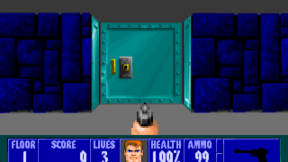
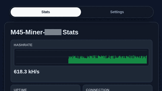
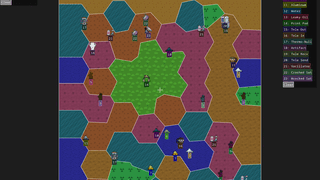
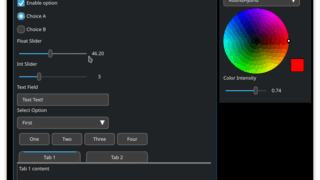
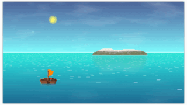
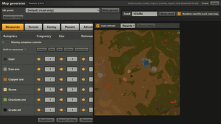
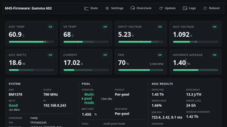
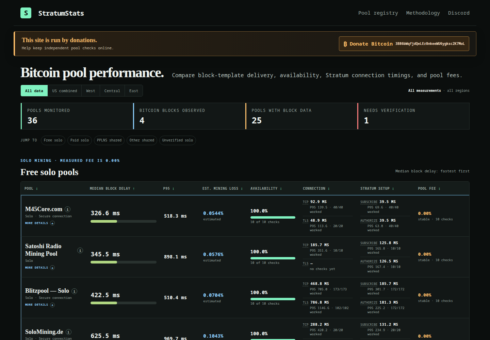

# Carl Otto · Distortions81

**Systems programming, embedded firmware, FPGA hardware, game engines, and infrastructure.**

I work across software, electronics, and data, usually with Go at the center.
My projects range from desktop and browser game engines to microcontroller
firmware, FPGA systems, and services used in day-to-day operations.

Most of my current work lives in private repositories. The overview below
covers that work as well as public projects you can explore, run, or play.

I approach projects iteratively: build, measure, refine, and document.
Benchmarks, visualizations, hardware experiments, and operational feedback help
me understand where a design works and where it needs another pass. Some
projects become maintained tools; others remain focused experiments in an
architecture, protocol, or piece of hardware.

## Private projects & ongoing engineering

Private work makes up a large part of my portfolio, especially in FPGA and
retrocomputing systems, embedded telemetry, infrastructure, and simulation.
These projects are described here without repository links.

### FPGA & retrocomputing

| Project | Focus |
| --- | --- |
| **Encore-4A** | TI-99/4A side-port snooper prototype for the Tang Nano 20K. Passively reconstructs VDP/PSG state for HDMI video and audio, with emulator-fed replay and a read-only hardware path. |
| **RetraceGPU** | Quake-oriented graphics system for the Tang Console Neo, pairing an Andes A25 CPU with FPGA rasterization, depth, textures, and lighting. Current work develops a SpinalHDL renderer and memory pipeline. |
| **Project-Retrace** | A 2D console and game-development computer for the Tang Console Neo. An Andes A25 CPU runs games while FPGA hardware provides 1080p output, scrolling tile planes, sprites, raster effects, and synthesis/PCM audio, with an SDK and desktop/browser runners. |
| **FocusTerm** | A Tang Nano 20K hardware terminal with a shared 80×24 display pipeline, multiple FPGA video targets, and an optional ESP32 companion for SSH and SPI connectivity. |
| **VectorFPGA** | Framebufferless vector-display engine for the Tang Mega 138K, demonstrated with Doom map geometry. One atomically updated vector list drives simultaneous 720p HDMI/DVI and X/Y oscilloscope output. |
| **TMX9999-FPGA** | Experimental TMS9900 instruction-set implementation and SoC for the Tang Nano 20K, with HDMI text/graphics, a UART monitor, flash-loaded firmware, and compiled BASIC. Instruction-set coverage is still incomplete. |
| **TangSHA256 / TangScrypt** | FPGA hashing experiments: a standalone Verilog SHA-256d scanner with a Go host, and a SpinalHDL Scrypt ROMix accelerator with on-chip scratchpads. SHA-256d results are simulation- and timing-tested; hardware validation remains separate. |
| **LM32-FPGA** | SpinalHDL LM32 integer soft CPU and SoC for the Tang Nano 20K, with on-chip RAM, an experimental SDRAM/cache profile, UART, HDMI text/graphics, flash access, and benchmark tooling. |

### UI toolkit

| Project | Focus |
| --- | --- |
| **EUI** | Native Go UI toolkit extracted from goThoom for Ebitengine, with windows, layouts, text controls, dialogs, embedded fonts and themes, display scaling, and an interactive Studio example. |

### Infrastructure, embedded systems & simulation

| Project | Focus |
| --- | --- |
| **BTCFlux** | A low-latency Bitcoin block-relay overlay with regional peers, compact-block transport, forward error correction, and a gateway to unmodified Bitcoin Core. Core retains block validation responsibility. |
| **Scout T1** | ESP32/MCP9808 temperature telemetry over ESP-NOW, with relays, an ESP32-S3 BLE gateway, and browser trends and history. Firmware and UI development are ahead of full hardware validation. |
| **BatteryMesh** | ESP32/ESP-NOW store-and-forward battery telemetry across sensor, relay, gateway, and bridge roles. Includes BLE and self-hosted web dashboards, current measurement, and capacity tracking. |
| **Facility38** | A factory-building game and massively parallel simulation proof of concept, exploring production, logistics, resource flows, and interacting systems at scale. |
| **goBitaxeRemote & data/protocol tools** | Miner telemetry collection and dashboards; Bitcoin coinbase-script inspection with ScriptSigSearch; the stratum-binary-batch protocol proposal; and byte-stream entropy/frequency visualization with bitgraph. |
| **Factorio support tools** | FactModDatDecode parses Factorio property-tree data. The archived relayServer project provided TCP-to-UDP tunnels for ChatWire. |
| **EvoLife** | Go ecosystem simulation with inherited traits, sensory motor networks, mutation, feeding guilds, and inspectable lineage and population history. Browser and native Ebitengine views share checkpoint-based experiments. |

## Selected public projects

These are useful entry points into the parts of my work available publicly.

| Project | What it does |
| --- | --- |
| [GD-DOOM](https://github.com/Distortions81/GD-DOOM) | A Doom engine and source port written in Go for desktop and browser. GPU drawing preserves the software-rendered appearance, with classic and modern presentation, WAD loading, saves, demos, and FM, SoundFont, or PC speaker audio. [Play](https://m45sci.xyz/u/dist/GD-DOOM/) |
| [GD-WOLF](https://github.com/Distortions81/GD-WOLF) | Wolfenstein 3D port in Go with CPU raycasting, GPU-accelerated pixel drawing and a software fallback. Includes native/browser builds, save previews, browser persistence, native positional audio, and original-engine comparison tools. [Play](https://m45sci.xyz/u/dist/GD-WOLF/) |
| [goThoom](https://github.com/Distortions81/goThoom) | A modern Windows, macOS, and Linux client for the classic Clan Lord MMORPG. Includes modern rendering and audio, session recording and playback, legacy macros, Go scripting, and optional text-to-speech. [Website & downloads](https://gothoom.m45sci.xyz/) |
| [EvenAudio](https://github.com/Distortions81/EvenAudio) | Linux desktop audio compressor with seven-band, stereo-linked processing, optional voice leveling, a C audio engine, and a Python/Tk interface for PulseAudio or PipeWire. |
| [goPine](https://github.com/Distortions81/goPineTime) | PineTime smartwatch firmware written in Go with TinyGo. Features clocks, alarms, timers, persistent settings, Bluetooth notifications and music controls, and firmware updates with on-watch confirmation and rollback. An active developer project, with battery runtime still being evaluated. |
| [M45-goPool](https://github.com/M45Core/M45-goPool) | A solo Bitcoin mining pool written from scratch in Go, integrating directly with Bitcoin Core over RPC/ZMQ. Includes Stratum/TLS, worker telemetry, a status dashboard and APIs, operational safeguards, and reproducible benchmarks. [Pool](https://m45core.com/) |
| [StratumStats](https://github.com/M45Core/StratumStats) | Mining-pool observability based on regional Stratum observations: block-template delivery, median and P95 delay, availability, connection timing, TLS, and coinbase-derived fee evidence. Raw observations remain independently recomputable. [Dashboard](https://stratumstats.m45core.com/) |
| [M45-Gamma-Firmware](https://github.com/M45Core/M45-Gamma-Firmware) | Experimental ESP32-S3 firmware for Bitaxe Gamma 602 miners, with weighted multi-pool mining, ordered backups, local and swarm dashboards, web updates, diagnostics, and opt-in overclocking with configurable limits. |
| [ChatWire](https://github.com/M45-Science/ChatWire) | Factorio server management and Discord integration, covering chat bridging, moderation, process lifecycle control, updates, player databases, and shared multi-instance deployments. |
| [M45-Core-Firmware](https://github.com/M45Core/M45-Core-Firmware) | Bitcoin mining firmware for supported classic ESP32-WROOM-32 OLED/LCD boards, with main and backup pools, on-device statistics, Wi-Fi setup, browser settings, and USB web flashing. |
| [StratumScout](https://github.com/M45Core/StratumScout) | Stateless regional probes that maintain Stratum connections continuously and upload an authenticated observation after each block window. Measures delivery and connection timing without submitting mining shares. |
| [GoMUD2](https://github.com/Distortions81/GoMUD2) | An experimental Go MUD server with telnet negotiation, optional TLS, Unicode and ANSI rendering, persistent accounts, chat channels, and basic in-game world editing. |
| [FactMapGen](https://github.com/M45-Science/FactMapGen) | A Go web editor for Factorio map-generation settings. Includes seeded previews for Nauvis and Space Age planets, exact Factorio rendering, guest workspaces, and authenticated, audited presets. [Try it](https://mapgen.m45sci.xyz/) |

## Project snapshots

Snapshots from across my public and private projects, including earlier versions and prototypes. Private projects are shown without repository links.

<table>
  <tr>
    <td align="center" width="20%">
      <a href="https://github.com/Distortions81/GD-DOOM">
         
        GD-DOOM
      </a>
    </td>
    <td align="center" width="20%">
      <a href="https://github.com/Distortions81/GD-WOLF">
         
        GD-WOLF
      </a>
    </td>
    <td align="center" width="20%">
      <a href="https://github.com/M45Core/M45-goPool">
         
        M45-goPool
      </a>
    </td>
    <td align="center" width="20%">
      <a href="https://github.com/M45Core/M45-Core-Firmware">
         
        M45-Core-Firmware
      </a>
    </td>
    <td align="center" width="20%">
      <a href="https://github.com/Distortions81/goThoom">
         
        goThoom
      </a>
    </td>
  </tr>
  <tr>
    <td align="center" width="20%">
      <a href="https://github.com/M45-Science/ChatWire">
         
        ChatWire
      </a>
    </td>
    <td align="center" width="20%">
      <a href="https://github.com/Distortions81/ONI-SeedView">
         
        ONI-SeedView · upstream API unavailable
      </a>
    </td>
    <td align="center" width="20%">
         
        EUI
    </td>
    <td align="center" width="20%">
      <a href="https://github.com/Distortions81/PixelPirates">
         
        PixelPirates
      </a>
    </td>
    <td align="center" width="20%">
      <a href="https://github.com/M45-Science/FactMapGen">
         
        FactMapGen
      </a>
    </td>
  </tr>
  <tr>
    <td align="center" width="20%">
       
      Encore-4A
    </td>
    <td align="center" width="20%">
       
      Project-Retrace · early prototype
    </td>
    <td align="center" width="20%">
       
      VectorFPGA
    </td>
    <td align="center" width="20%">
      <a href="https://github.com/M45Core/M45-Gamma-Firmware">
         
        M45-Gamma-Firmware
      </a>
    </td>
    <td align="center" width="20%">
      <a href="https://github.com/M45Core/StratumStats">
         
        StratumStats
      </a>
    </td>
  </tr>
</table>

## Communities & operations

**[M45-Science](https://github.com/M45-Science)** is where my Factorio community
and server-operations work lives. The public tooling spans Discord integration,
moderation, server orchestration, community lists, downloads, and map management.
ChatWire and FactMapGen are two parts of that wider stack.
[Community website](https://m45sci.xyz/)

**[M45Core](https://github.com/M45Core)** brings together my Bitcoin mining
software, firmware, and observability work. Its projects cover pool servers,
ESP32 and ASIC miner firmware, and distributed regional measurement.

## More public work

- **Games:** [PixelPirates](https://github.com/Distortions81/PixelPirates) and [GoblinSiege](https://github.com/Distortions81/GoblinSiege).
- **Audio & libraries:** [go-meltysynth](https://github.com/Distortions81/go-meltysynth), [ImpSynth](https://github.com/Distortions81/ImpSynth), [GoBeep86](https://github.com/Distortions81/GoBeep86), [go-g726](https://github.com/Distortions81/go-g726), and [goXA](https://github.com/Distortions81/goXA).
- **Linux & practical tools:** [DaVinci-Resolve-Container](https://github.com/Distortions81/DaVinci-Resolve-Container), [Canon-Webcam-Linux](https://github.com/Distortions81/Canon-Webcam-Linux), and [PCB-Frame](https://github.com/Distortions81/PCB-Frame).
- **Math & visualization:** [OpenCLFrac](https://github.com/Distortions81/OpenCLFrac), [golang-frac](https://github.com/Distortions81/golang-frac), and [StrangeAttractors](https://github.com/Distortions81/StrangeAttractors).

[Browse my public repositories →](https://github.com/Distortions81?tab=repositories)
