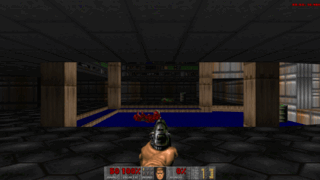
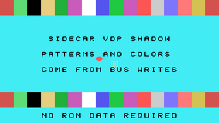
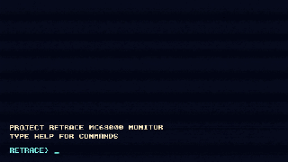
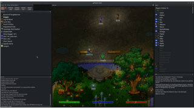
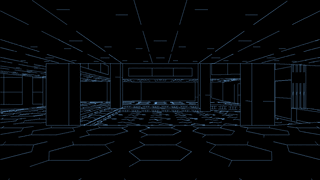
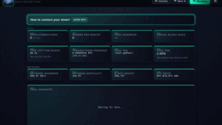

# Carl Otto · Distortions81

**Systems programming, embedded firmware, FPGA hardware, game engines, and infrastructure.**

I work across software, electronics, and data, usually with Go at the center.
My projects range from desktop and browser game engines to microcontroller
firmware, FPGA systems, and services used in day-to-day operations.

Most of my current work lives in private repositories. The overview below
covers that work as well as public projects you can explore, run, or play.

I approach projects iteratively: build, measure, refine, and document.
Benchmarks, visualizations, hardware experiments, and operational feedback help
me understand where a design works and where it needs another pass. Some
projects become maintained tools; others remain focused experiments in an
architecture, protocol, or piece of hardware.

## Private projects & ongoing engineering

Private work makes up a large part of my portfolio, especially in FPGA and
retrocomputing systems, embedded telemetry, infrastructure, and simulation.
These projects are described here without repository links.

### FPGA & retrocomputing

| Project | Focus |
| --- | --- |
| **Encore-4A** | A passive TI-99/4A side-port snooper for the Tang Nano 20K. It reconstructs VDP and PSG state to produce HDMI video and audio, with emulator-fed replay support for development and comparison. |
| **Project-Retrace** | A modern retrocomputing platform built around the Tang Console 138K. It combines an in-tree MC68000-compatible soft CPU, 720p HDMI text and packed framebuffers, flash-loaded applications, and BL616 USB input. The goal is an understandable system with modern conveniences. |
| **FocusTerm** | A Tang Nano 20K hardware terminal with a shared 80×24 display pipeline, multiple FPGA video targets, and an optional ESP32 companion for SSH and SPI connectivity. |
| **VectorFPGA** | A 3D vector interpretation of Doom, with a framebufferless Tang Mega 138K renderer. One atomic UART-fed vector list drives either 720p HDMI or analog X/Y output for an oscilloscope. |
| **TMX9999-FPGA** | TMS9900-compatible soft CPU and SoC work, including HDMI text and graphics, a UART monitor, flash-loaded firmware, and compiled BASIC bring-up. |
| **LM32-FPGA** | An attempt to build a fast, binary-compatible LatticeMico32 implementation, wrapped in a small SoC with RAM, UART, LED I/O, HDMI, flash storage, and benchmark tooling. |

### Infrastructure, embedded systems & simulation

| Project | Focus |
| --- | --- |
| **BatteryMesh** | ESP32/ESP-NOW store-and-forward battery telemetry across sensor, relay, gateway, and bridge roles. Includes BLE and self-hosted web dashboards, current measurement, and capacity tracking. |
| **ProtonSync** | An upload-first Proton Drive sync helper for Linux, combining inotify watching, file-stability checks, hashed state, a terminal UI, and explicit safety modes. |
| **Facility38** | A factory-building game and massively parallel simulation proof of concept, exploring production, logistics, resource flows, and interacting systems at scale. |
| **PoolCensus, goBitaxeRemote & related Bitcoin tooling** | Private tools for pool measurement, miner management, data inspection, and operations, alongside experiments such as ScriptSigSearch, stratum-binary-batch, and bitgraph. |
| **FactModDatDecode & relayServer** | Supporting Factorio tooling for mod-data decoding and server infrastructure. |
| **LumenClay, Void-Colony, Shellworld & Network-Sim** | Experiments in simulation, MUDs, terminal games, and connected systems. |

Other private experiments include forward error correction, compression,
image/QR handling, audio, and modeling through projects such as **GFEC**,
**chatCompress**, **QR-Img**, **ottoWave**, **ottoWave2**, and **dm_bias_fit**.

## Selected public projects

These are useful entry points into the parts of my work available publicly.

| Project | What it does |
| --- | --- |
| [GD-DOOM](https://github.com/Distortions81/GD-DOOM) | A Doom engine and source port written in Go for desktop and browser. GPU drawing preserves the software-rendered appearance, with classic and modern presentation, WAD loading, saves, demos, and FM, SoundFont, or PC speaker audio. [Play](https://m45sci.xyz/u/dist/GD-DOOM/) |
| [goThoom](https://github.com/Distortions81/goThoom) | A modern Windows, macOS, and Linux client for the classic Clan Lord MMORPG. Includes modern rendering and audio, session recording and playback, legacy macros, Go scripting, and optional text-to-speech. [Website & downloads](https://gothoom.m45sci.xyz/) |
| [goPine](https://github.com/Distortions81/goPineTime) | PineTime smartwatch firmware written in Go with TinyGo. Features clocks, alarms, timers, persistent settings, Bluetooth notifications and music controls, and firmware updates with on-watch confirmation and rollback. An active developer project, with battery runtime still being evaluated. |
| [M45-goPool](https://github.com/M45Core/M45-goPool) | A solo Bitcoin mining pool written from scratch in Go, integrating directly with Bitcoin Core over RPC/ZMQ. Includes Stratum/TLS, worker telemetry, a status dashboard and APIs, operational safeguards, and reproducible benchmarks. [Pool](https://m45core.com/) |
| [StratumStats](https://github.com/M45Core/StratumStats) | Mining-pool observability based on regional Stratum observations: block-template delivery, median and P95 delay, availability, connection timing, TLS, and coinbase-derived fee evidence. Raw observations remain independently recomputable. [Dashboard](https://stratumstats.m45core.com/) |
| [M45-Gamma-Firmware](https://github.com/M45Core/M45-Gamma-Firmware) | ESP32-S3 firmware for Bitaxe Gamma 602 miners. Combines weighted multi-pool share splitting, ordered backup pools, a live dashboard, web updates, hardware diagnostics, and safety controls. |
| [ChatWire](https://github.com/M45-Science/ChatWire) | Factorio server management and Discord integration, covering chat bridging, moderation, process lifecycle control, updates, player databases, and shared multi-instance deployments. |
| [FactMapGen](https://github.com/M45-Science/FactMapGen) | A Go web editor for Factorio map-generation settings. Includes seeded previews for Nauvis and Space Age planets, exact Factorio rendering, guest workspaces, and authenticated, audited presets. [Try it](https://mapgen.m45sci.xyz/) |

## Project snapshots

A few views from the public and private work above.

<table>
  <tr>
    <td align="center" width="33%">
      <a href="https://github.com/Distortions81/GD-DOOM">
         
        GD-DOOM · public
      </a>
    </td>
    <td align="center" width="33%">
       
      Encore-4A · private
    </td>
    <td align="center" width="33%">
       
      Project-Retrace · private
    </td>
  </tr>
  <tr>
    <td align="center">
      <a href="https://github.com/Distortions81/goThoom">
         
        goThoom · public
      </a>
    </td>
    <td align="center">
       
      VectorFPGA · private
    </td>
    <td align="center">
      <a href="https://github.com/M45Core/M45-goPool">
         
        M45-goPool · public
      </a>
    </td>
  </tr>
</table>

## Communities & operations

**[M45-Science](https://github.com/M45-Science)** is where my Factorio community
and server-operations work lives. The public tooling spans Discord integration,
moderation, server orchestration, community lists, downloads, and map management.
ChatWire and FactMapGen are two parts of that wider stack.
[Community website](https://m45sci.xyz/)

**[M45Core](https://github.com/M45Core)** brings together my Bitcoin mining
software, firmware, and observability work. Alongside goPool, Gamma firmware,
and StratumStats, it includes
[M45-Core-Firmware](https://github.com/M45Core/M45-Core-Firmware) for classic ESP32
mining hardware and [StratumScout](https://github.com/M45Core/StratumScout) for
distributed regional measurements.

## More public work

- **Engines & games:** [GD-WOLF](https://github.com/Distortions81/GD-WOLF), [GoMUD2](https://github.com/Distortions81/GoMUD2), [PixelPirates](https://github.com/Distortions81/PixelPirates), and [GoblinSiege](https://github.com/Distortions81/GoblinSiege).
- **Audio & libraries:** [go-meltysynth](https://github.com/Distortions81/go-meltysynth), [ImpSynth](https://github.com/Distortions81/ImpSynth), [GoBeep86](https://github.com/Distortions81/GoBeep86), [go-g726](https://github.com/Distortions81/go-g726), and [goXA](https://github.com/Distortions81/goXA).
- **Linux & practical tools:** [DaVinci-Resolve-Container](https://github.com/Distortions81/DaVinci-Resolve-Container), [Canon-Webcam-Linux](https://github.com/Distortions81/Canon-Webcam-Linux), and [PCB-Frame](https://github.com/Distortions81/PCB-Frame).
- **Math & visualization:** [OpenCLFrac](https://github.com/Distortions81/OpenCLFrac), [golang-frac](https://github.com/Distortions81/golang-frac), and [StrangeAttractors](https://github.com/Distortions81/StrangeAttractors).

[Browse my public repositories →](https://github.com/Distortions81?tab=repositories)
